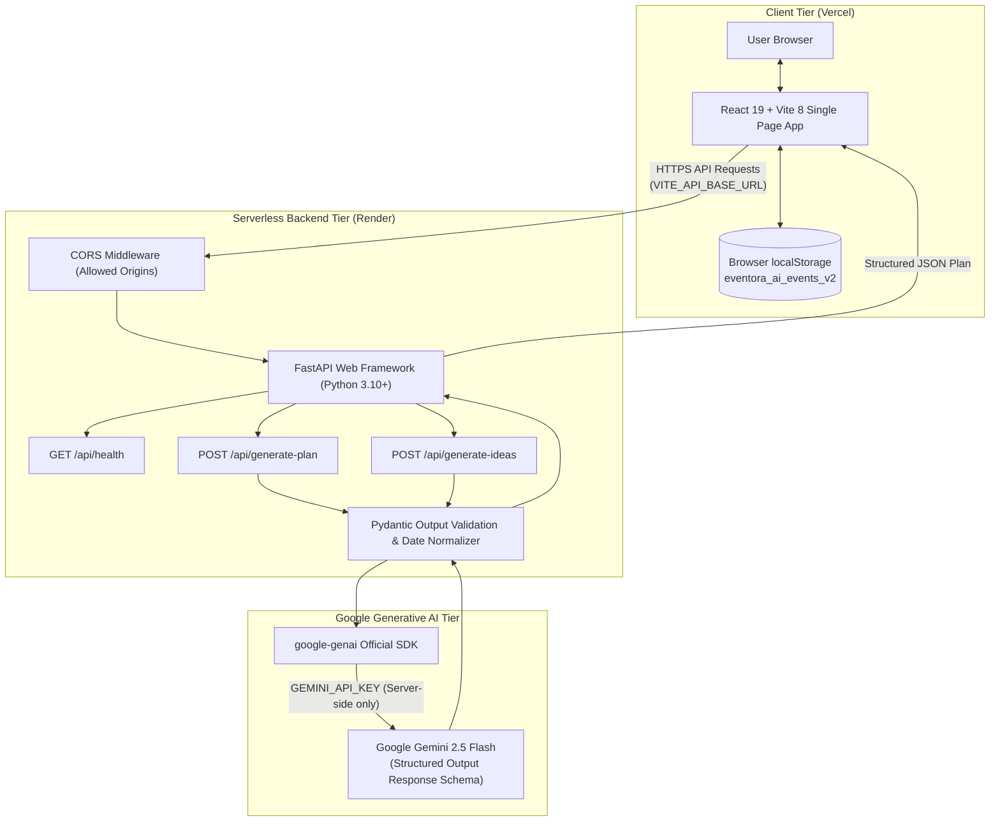
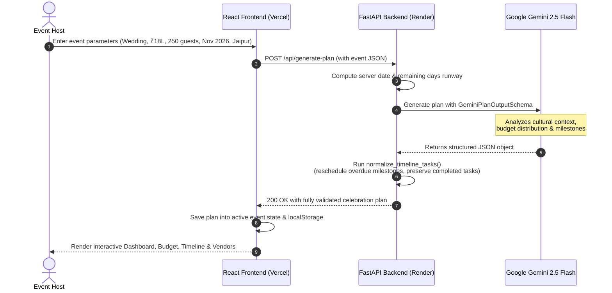

# Eventora AI

<div align="center">

### *Beautiful Moments Deserve Thoughtful Planning.*

An editorial celebration planning platform and operating system powered by **Google Gemini Generative AI** and a **Python FastAPI** backend. Designed for weddings, milestone birthdays, and community festivals.

[](https://eventora-ai-ten.vercel.app/)
[](https://github.com/pvsatvika/Eventora-AI)
[](https://eventora-ai-backend.onrender.com/api/health)

<br/>

[](https://react.dev/)
[](https://vitejs.dev/)
[](https://tailwindcss.com/)
[](https://www.python.org/)
[](https://fastapi.tiangolo.com/)
[](https://ai.google.dev/)
[](https://hack2skill.com/)

<br/>

**[🌐 Launch Live Application](https://eventora-ai-ten.vercel.app/)** &nbsp;•&nbsp; **[📡 Backend API Health](https://eventora-ai-backend.onrender.com/api/health)** &nbsp;•&nbsp; **[📂 GitHub Repository](https://github.com/pvsatvika/Eventora-AI)**

</div>

---

## 📖 Table of Contents

- [Project Overview](#-project-overview)
- [The Problem](#-the-problem)
- [Our Solution](#-our-solution)
- [Key Features](#-key-features)
- [Screenshots & Visual Preview](#-screenshots--visual-preview)
- [System Architecture](#-system-architecture)
- [Technology Stack](#-technology-stack)
- [How the AI Planning Engine Works](#-how-the-ai-planning-engine-works)
- [Getting Started](#-getting-started)
  - [Prerequisites](#prerequisites)
  - [1. Clone Repository](#1-clone-repository)
  - [2. Frontend Setup (React + Vite)](#2-frontend-setup-react--vite)
  - [3. Backend Setup (FastAPI + Python)](#3-backend-setup-fastapi--python)
- [Environment Variables](#-environment-variables)
- [API Endpoints](#-api-endpoints)
- [Production Deployment](#-production-deployment)
  - [Frontend on Vercel](#frontend-on-vercel)
  - [Backend on Render](#backend-on-render)
- [Suggested Demo Walkthrough](#-suggested-demo-walkthrough)
- [Limitations & Future Roadmap](#-limitations--future-roadmap)
- [Hackathon Attribution](#-hackathon-attribution)
- [License & Intellectual Property](#-license--intellectual-property)

---

## 🌟 Project Overview

**Eventora AI** is an intelligent, full-stack celebration planning platform designed for **Hack2Skill PromptWars Challenge 5**.

Whether organizing a multi-day Indian wedding with intricate rituals, a curated milestone 30th birthday gathering, or a 400-guest community festival, traditional event planning is often stressful, fragmented across spreadsheets, and disconnected from creative design.

Eventora AI pairs the aesthetic warmth and serenity of a luxury lifestyle publication with a structured, AI-powered celebration operating system. By integrating **Google Gemini Generative AI** (`gemini-2.5-flash`) through a secure **FastAPI** backend, Eventora transforms high-level event ideas—date, location, budget in INR, attendee count, and aesthetic preferences—into an actionable, end-to-end event plan complete with category budgets, chronological timelines, vendor checklists, and creative styling concepts.

---

## 🧩 The Problem

Event hosts and couples face recurring obstacles when planning personal or community celebrations:

1. **Budget Ambiguity**: Estimating realistic category allocations (venue, catering, decor, photography) in Indian Rupee (INR) amounts without past industry benchmarks often leads to early budget exhaustion.
2. **Timeline Confusion**: Traditional planning checklists fail to adapt to how much time remains before the celebration date, resulting in unrealistic or overdue deadlines.
3. **Vendor Coordination Chaos**: Tracking vendor quotes, token deposits, contract deliverables, and booking statuses across chat threads and paper notes causes miscommunication.
4. **Generic AI Advice**: Off-the-shelf conversational chatbots provide generic bulleted lists rather than interactive, editable, persistent spreadsheets and task boards.
5. **Overwhelming, Clinical Interfaces**: Most existing event management tools look like generic corporate project trackers rather than inspiring lifestyle experiences.

---

## 💡 Our Solution

Eventora AI bridges the gap between **generative intelligence** and **tactile productivity**:

- **Structured AI Generation**: Instead of unstructured chat text, Gemini returns strictly typed JSON schemas with calibrated INR financial distributions, chronological deliverables, vendor partner checklists, and styling ideas.
- **Dynamic Date Normalization**: AI deadlines are server-validated against the current live date. Pre-event deadlines are never set in the past, and traditional milestones are intelligently compressed into upcoming actionable phases.
- **Interactive Operating Dashboard**: Every AI-generated plan is completely editable. Users can adjust category budgets, log advance payments, toggle deliverable completions, update vendor statuses, and schedule creative concepts directly into their timeline.
- **Dual-Engine Flexibility**: Features a live **Google Gemini 2.5 Flash** backend engine for custom AI generation, paired with an offline-capable **Curated Demo Engine** for instant testing without mandatory API keys.
- **Editorial Aesthetic Identity**: Built around a warm ivory (`#FAF8F4`), botanical sage green (`#748C78`), and muted blush palette with classic *Playfair Display* serif headlines and readable *DM Sans* body typography.

---

## ⚡ Key Features

| Feature | Description |
| :--- | :--- |
| **🤖 AI Celebration Blueprint Generator** | Synthesizes an entire celebration operating plan from event type, budget (INR), date, location, guest count, and aesthetic theme preferences. |
| **💰 INR Budget Planner & Expense Tracker** | Allocates celebration budgets across categories (Venue, Catering, Floral & Decor, Photography, Entertainment, Contingency) with inline editing, expense logging, settlement tracking, and deficit warnings. |
| **📅 Phased Chronological Timeline** | Deliverables sequenced from planning kickoff down to the day of the event and post-event wraps. Includes past-date healing, priority badges, and overdue detection. |
| **🤝 Vendor Coordination Checklist** | Tracks vendor disciplines, suggested service titles, estimated cost quotes, token deposits, contact persons, notes, and booking statuses (`Not Started` to `Booked`). |
| **✨ Creative Ideas Synthesizer** | Generates bespoke concepts for themes, decor, food & cocktails, and entertainment. Clicking *"Add to Plan"* calculates an appropriate preparation deadline and adds it directly to the timeline. |
| **🔔 Non-Blocking Toast Notifications** | Tasteful, accessible notification system replacing disruptive browser alerts with contextual feedback and direct navigation links. |
| **📊 Holistic Celebration Dashboard** | Live readiness score calculation (derived from completed deliverables and secured vendor contracts), days-to-go countdown, budget utilization bars, and urgent action items. |
| **💾 LocalStorage Persistence** | All updates, expenses, customized tasks, and event switches are saved locally (`eventora_ai_events_v2`) with automatic legacy data self-healing. |
| **🗂️ Multi-Event Manager** | Switch seamlessly between different celebrations, create new blueprints, or reset back to curated templates. |

---

## 📸 Screenshots & Visual Preview

> *Note: Place high-resolution application screenshots in `docs/screenshots/` with the filenames indicated below to render visual previews directly on GitHub.*

### 1. Editorial Landing Page
```
[ Placeholder: Landing Page Hero & Category Showcase ]
File target: docs/screenshots/01-landing-page.png
```
*A split-screen editorial landing page introducing Eventora AI with lifestyle photography, event category cards, and workflow previews.*

---

### 2. Event Blueprint Generator (`/create`)
```
[ Placeholder: Event Creation Form & AI Engine Indicator ]
File target: docs/screenshots/02-create-event.png
```
*Interactive celebration setup form with real-time Gemini backend health detection, INR budget sliders, and style preferences.*

---

### 3. Celebration Dashboard (`/dashboard`)
```
[ Placeholder: Readiness Score, Days-to-Go, and Metric Overview ]
File target: docs/screenshots/03-dashboard.png
```
*Unified event control room featuring the verified readiness score, days-to-go countdown, budget utilization bars, and upcoming milestone deliverables.*

---

### 4. Budget Planner & Expense Log (`/budget`)
```
[ Placeholder: Category Allocations & Expense Table ]
File target: docs/screenshots/04-budget-page.png
```
*Interactive category allocation cards formatted in Indian Rupees (`Intl.NumberFormat('en-IN')`), expense logger, and settlement tracking.*

---

### 5. Chronological Timeline & Tasks (`/timeline`)
```
[ Placeholder: Phased Deliverables Roadmap ]
File target: docs/screenshots/05-timeline-page.png
```
*Chronological milestone execution roadmap grouped by phase with priority filters and past-date prevention.*

---

### 6. Vendor Checklist (`/vendors`)
```
[ Placeholder: Vendor Quotes & Deposit Management ]
File target: docs/screenshots/06-vendors-page.png
```
*Vendor coordination directory with advance deposit tracking, contact cards, and status selectors.*

---

### 7. Creative Ideas Synthesizer (`/ideas`)
```
[ Placeholder: AI Creative Concepts with "Add to Plan" ]
File target: docs/screenshots/07-ideas-page.png
```
*AI-synthesized themes, decor, culinary concepts, and entertainment ideas with intelligent deadline scheduling.*

---

## 🏗️ System Architecture

Eventora AI operates on a modern, decoupled full-stack architecture that isolates generative AI keys on a Python server while delivering a snappy, zero-latency React client:



### Architecture Highlights
1. **Zero Secret Exposure**: The `GEMINI_API_KEY` is loaded strictly inside Python via `python-dotenv` from `backend/.env`. It is never bundled into client JavaScript or accessible via browser network headers.
2. **Deterministic Schemas**: Uses Pydantic's `response_schema` alongside Gemini's structured output mode to guarantee typed outputs without broken markdown formatting.
3. **Client-Side State Autonomy**: The client maintains complete offline independence via React Context and `localStorage`, ensuring data persists across page refreshes.

---

## 🛠️ Technology Stack

| Layer | Technology | Version | Purpose in Eventora AI |
| :--- | :--- | :--- | :--- |
| **Frontend Framework** | **React** | `^19.3.1` | Component-driven UI, state management, and hooks |
| **Build Tool & Bundler** | **Vite** | `^8.3.4` | Lightning-fast development server and optimized build pipeline |
| **Styling & Design** | **Tailwind CSS** | `^4.3.3` | Utility-first responsive design, custom ivory & sage palette |
| **Icons** | **Lucide React** | `^1.60.0` | Clean, modern lifestyle and navigation icons |
| **Client Routing** | **React Router DOM** | `^7.18.4` | Client-side routing between landing, dashboard, and planners |
| **Delight / Feedback** | **Canvas Confetti** | `^1.9.4` | Celebration completion celebratory visual effects |
| **Backend Framework** | **FastAPI** | `>=0.115.0` | High-performance asynchronous Python REST API |
| **ASGI Web Server** | **Uvicorn** | `>=0.30.0` | Production ASGI web server running FastAPI |
| **AI SDK** | **google-genai** | `>=2.17.0` | Official Google Gen AI Python SDK interfacing with Gemini |
| **Data Validation** | **Pydantic** | `>=2.8.0` | Strict request validation and structured output response schemas |
| **Environment Config** | **python-dotenv** | `>=1.0.0` | Secure environment variable management |
| **HTTP Client** | **HTTPX** | `>=0.28.0` | High-level async HTTP client support |
| **Frontend Deployment** | **Vercel** | — | Production static SPA hosting with HTTPS & CDN edge delivery |
| **Backend Deployment** | **Render** | — | Fully managed Python cloud web service |

---

## 🧠 How the AI Planning Engine Works



1. **Parameter Gathering**: The user specifies event type, title, location, target date, budget in INR, attendee count, and design vision.
2. **Context Enrichment**: The FastAPI service computes the live calendar difference between the current server date and the event date.
3. **Structured Prompting**: The backend constructs an enriched prompt instructing Gemini to act as a luxury event planner with deep cultural awareness (e.g. Indian wedding traditions, Sangeet choreography, milestone birthdays).
4. **Structured Schema Enforcement**: Output is constrained using Pydantic schemas (`GeminiPlanOutputSchema`), ensuring budget percentages total 100% and tasks have valid relative offsets.
5. **Timeline Normalization**: The backend checks generated task deadlines against today's date. Any milestone that would traditionally fall in the past is automatically rescheduled into an immediate upcoming actionable phase.
6. **Seamless State Ingestion**: The frontend receives the normalized payload, binds it to the active celebration ID, saves it in `localStorage`, and transitions the user to the interactive dashboard.

---

## 🚀 Getting Started

Follow these steps to run the complete Eventora AI full-stack application on your local machine.

### Prerequisites
- **Node.js**: v18.0.0 or higher ([Download Node.js](https://nodejs.org/))
- **Python**: v3.10 or higher ([Download Python](https://www.python.org/))
- **Git**: Installed and configured
- **Google Gemini API Key**: Free key from [Google AI Studio](https://aistudio.google.com/)

---

### 1. Clone Repository

```bash
git clone https://github.com/pvsatvika/Eventora-AI.git
cd Eventora-AI
```

---

### 2. Frontend Setup (React + Vite)

In the root repository directory:

```bash
# 1. Install frontend dependencies
npm install

# 2. Configure environment (optional for local dev)
# By default, api.js points to http://localhost:8000 if VITE_API_BASE_URL is omitted.
cp .env.example .env

# 3. Start the Vite development server
npm run dev
```

The frontend will start at:  
👉 **`http://localhost:5173/`**

---

### 3. Backend Setup (FastAPI + Python)

Open a **second terminal window** and navigate into the `backend/` directory:

```bash
cd backend

# 1. Create a Python virtual environment
python -m venv venv

# 2. Activate the virtual environment
# On Windows PowerShell:
.\venv\Scripts\Activate.ps1
# On Windows Command Prompt:
.\venv\Scripts\activate.bat
# On macOS / Linux:
source venv/bin/activate

# 3. Install Python dependencies
pip install -r requirements.txt

# 4. Configure your backend environment
cp .env.example .env
```

Open `backend/.env` in your text editor and insert your Gemini API key:

```env
# Google Gemini API Key from Google AI Studio
GEMINI_API_KEY=your_actual_gemini_api_key_here

# Configurable Gemini Model
GEMINI_MODEL=gemini-2.5-flash

# Port for local FastAPI server
PORT=8000

# Allowed Frontend Origins for CORS
CORS_ORIGINS=http://localhost:5173,http://127.0.0.1:5173,http://localhost:4173
```

Now start the FastAPI backend server:

```bash
python main.py
# Or directly via uvicorn:
uvicorn main:app --reload --port 8000
```

The backend server will start at:
- **API Root**: `http://localhost:8000/`
- **Health Check**: `http://localhost:8000/api/health`
- **Interactive Swagger Docs**: `http://localhost:8000/docs`

---

## 🔐 Environment Variables

### Frontend Variables (`.env` in root)

| Variable | Required | Default | Description |
| :--- | :---: | :--- | :--- |
| `VITE_API_BASE_URL` | **Production** | `http://localhost:8000` | Points to deployed FastAPI backend (e.g. `https://eventora-ai-backend.onrender.com`). |

> [!IMPORTANT]
> Never place `GEMINI_API_KEY` in the frontend root `.env` or prefix it with `VITE_`. Gemini API calls must execute exclusively through the backend.

### Backend Variables (`backend/.env`)

| Variable | Required | Default | Description |
| :--- | :---: | :--- | :--- |
| `GEMINI_API_KEY` | **Yes** | *None* | Valid Google Gemini API key obtained from [Google AI Studio](https://aistudio.google.com/). |
| `GEMINI_MODEL` | No | `gemini-2.5-flash` | Configurable Google Gen AI model name (`gemini-2.5-flash`, `gemini-2.0-flash`, etc.). |
| `PORT` | No | `8000` | Port for the Uvicorn ASGI server to bind. Injected automatically on Render. |
| `CORS_ORIGINS` | No | `http://localhost:5173,...` | Comma-separated list of allowed browser origins for cross-origin requests. |

---

## 📡 API Endpoints

The FastAPI backend exposes three purpose-built REST endpoints:

### 1. `GET /api/health`
Verifies backend operational status and whether a non-placeholder Gemini API key is loaded.

**Sample Response**:
```json
{
  "status": "ok",
  "gemini_configured": true,
  "model": "gemini-2.5-flash",
  "version": "1.0.0"
}
```

---

### 2. `POST /api/generate-plan`
Accepts user event parameters and generates a complete celebration blueprint.

**Sample Request Payload**:
```json
{
  "event_type": "wedding",
  "event_name": "Ananya & Kabir's Royal Sangeet & Reception",
  "event_date": "2026-11-20",
  "location": "Jaipur, Rajasthan",
  "total_budget": 1800000,
  "guest_count": 250,
  "theme_preferences": "Royal Rajputana with Twilight Gold & Pastel Florals",
  "special_requirements": "Strictly vegetarian banquet and step-free wheelchair access",
  "existing_completed_tasks": []
}
```

**Key Response Fields**:
- `overview_summary`: Tailored editorial narrative for the celebration.
- `theme_palette`: 3 to 4 complementary aesthetic colors/motifs.
- `key_recommendations`: Practical tips based on location, guest volume, and season.
- `budget_categories`: Recommended INR allocations totaling 100% of the total budget.
- `timeline_tasks`: Chronological deliverables with normalized due dates and phases.
- `vendor_checklist`: Recommended vendor disciplines with estimated costs in INR.
- `creative_ideas`: Tailored creative styling and entertainment concepts.

---

### 3. `POST /api/generate-ideas`
Synthesizes fresh creative concepts categorized by theme, decor, food & beverages, or entertainment.

**Sample Request Payload**:
```json
{
  "event_name": "Ananya & Kabir's Royal Sangeet & Reception",
  "event_type": "wedding",
  "theme": "Royal Rajputana",
  "guest_count": 250,
  "total_budget": 1800000,
  "location": "Jaipur, Rajasthan",
  "category": "all"
}
```

**Sample Response**:
```json
{
  "ideas": [
    {
      "type": "decor",
      "title": "Marigold & Brass Candle Cascade",
      "tag": "Decor & Styling",
      "description": "Suspended brass thalis with fragrant marigolds and slow-burning candlelight along entry corridors.",
      "cost_impact": "Moderate"
    }
  ]
}
```

---

## 🌐 Production Deployment

Eventora AI is deployed across high-availability cloud infrastructure:

### Frontend on Vercel
- **Production URL**: [https://eventora-ai-ten.vercel.app/](https://eventora-ai-ten.vercel.app/)
- **Repository Root**: `./`
- **Framework Preset**: Vite
- **Build Command**: `npm run build`
- **Output Directory**: `dist`
- **Environment Variables**:
  - `VITE_API_BASE_URL` = `https://eventora-ai-backend.onrender.com`

### Backend on Render
- **Production URL**: [https://eventora-ai-backend.onrender.com](https://eventora-ai-backend.onrender.com)
- **Root Directory**: `backend`
- **Environment**: Python 3
- **Build Command**: `pip install -r requirements.txt`
- **Start Command**: `uvicorn main:app --host 0.0.0.0 --port $PORT`
- **Environment Variables**:
  - `GEMINI_API_KEY` = `[Configured in Render Secrets]`
  - `GEMINI_MODEL` = `gemini-2.5-flash`
  - `CORS_ORIGINS` = `https://eventora-ai-ten.vercel.app,http://localhost:5173`

---

## 🧭 Suggested Demo Walkthrough

Judges and evaluators can follow this step-by-step walkthrough to test the full feature set:

1. **Landing Page Exploration**: Open [https://eventora-ai-ten.vercel.app/](https://eventora-ai-ten.vercel.app/). Review the editorial aesthetic, category cards, interactive preview celebration, and workflow breakdown. Click **"Plan Your Celebration"**.
2. **Create Celebration (`/create`)**:
   - Select an event category (e.g. **Wedding & Sangeet**).
   - Notice the live badge in the top right: `Google Gemini (gemini-2.5-flash) Connected`.
   - Fill in or customize the event parameters (e.g. Budget: ₹18,00,000, Date: 3+ months ahead, City: Jaipur).
   - Click **"Generate Celebration Blueprint"**. Watch the dynamic progress stage indicators.
3. **Explore Dashboard (`/dashboard`)**:
   - Inspect the **Celebration Readiness Score** (dynamically computed from completed tasks and vendor bookings).
   - Review the **Days to Go** countdown and budget allocation progress bars.
4. **Manage Budget (`/budget`)**:
   - Review AI-distributed category allocations formatted in INR (`₹`).
   - Click the pencil icon on any category to adjust the planned allocation.
   - Click **"Record Expense"** to log an advance payment or venue deposit.
   - Observe the safe remaining budget balance and settlement totals recalculating in real-time.
5. **Execute Timeline Milestones (`/timeline`)**:
   - Browse chronological deliverables grouped into phased horizons.
   - Click deliverable checkboxes to mark milestones completed; observe the progress bar updating.
   - Click **"Add Deliverable"** to add a custom action item.
6. **Coordinate Vendors (`/vendors`)**:
   - Examine recommended vendor roles and estimated target quotes.
   - Change a vendor's booking status from `Researching` to `Deposit Paid` or `Booked`.
   - Return to the Dashboard and watch the **Readiness Score** rise accordingly.
7. **Synthesize Creative Ideas (`/ideas`)**:
   - Browse curated concepts across Themes, Decor, Food, and Entertainment.
   - Click **"Add to Plan"** on an idea card: notice the non-blocking toast confirming the deliverable was scheduled before the event date.
   - Click the idea again to verify duplicate deliverable protection.
8. **Event Manager (`/events`)**:
   - Navigate to **Celebrations** in the top navigation.
   - Switch between sample events or manage saved celebrations stored in `localStorage`.

---

## ⚠️ Limitations & Future Roadmap

To uphold technical documentation integrity, the following outlines current implementation boundaries and planned enhancements:

### Current Limitations
- **Client-Side Storage**: Data is persisted locally within the user's browser `localStorage`. Clearing browser cache resets state to initial defaults.
- **Simulated Vendor Directory**: AI vendor entries provide realistic suggested categories, estimated quote targets, and checklists; they are not connected to live external vendor directory APIs.
- **Manual Expense Settlement**: The budget tracker facilitates manual financial record-keeping in INR; it does not process live bank transactions or real credit card payments.
- **Single-User Workspace**: There is currently no multi-tenant authentication system for simultaneous multi-user collaboration.

### Future Roadmap
- [ ] **Cloud Persistence & Auth**: Optional user accounts via Supabase / PostgreSQL for cross-device synchronization.
- [ ] **Collaborative Planning**: Shared invite links allowing co-hosts, partners, and family committees to edit simultaneously.
- [ ] **Document Export**: One-click export of timelines and budget balance sheets to PDF, Google Calendar, and Excel (.xlsx).
- [ ] **Guest RSVP Portal**: Simple link generator for attendees to submit dietary requirements and confirm attendance.

---

## 🏆 Hackathon Attribution

Eventora AI was designed, built, and submitted for:
- **Hackathon**: [Hack2Skill PromptWars Challenge 5](https://hack2skill.com/)
- **Track**: Generative AI Celebration Planning Web Application
- **Author & Maintainer**: **Satvika PV** ([@pvsatvika](https://github.com/pvsatvika))
- **Repository**: [https://github.com/pvsatvika/Eventora-AI](https://github.com/pvsatvika/Eventora-AI)

---

## 📜 License & Intellectual Property

This repository does not currently contain an open-source license file. All rights are reserved by the author (**Satvika PV**) for the **Hack2Skill PromptWars Challenge 5** hackathon submission. For collaboration or permission requests, please contact the maintainer via [GitHub](https://github.com/pvsatvika/Eventora-AI).

---

<div align="center">

### Eventora AI
*Bringing thoughtfulness, serenity, and intelligence to life's most meaningful moments.*

[🌟 Star on GitHub](https://github.com/pvsatvika/Eventora-AI) &nbsp;•&nbsp; [🚀 Open Live App](https://eventora-ai-ten.vercel.app/) &nbsp;•&nbsp; [🐛 Report an Issue](https://github.com/pvsatvika/Eventora-AI/issues)

</div>
