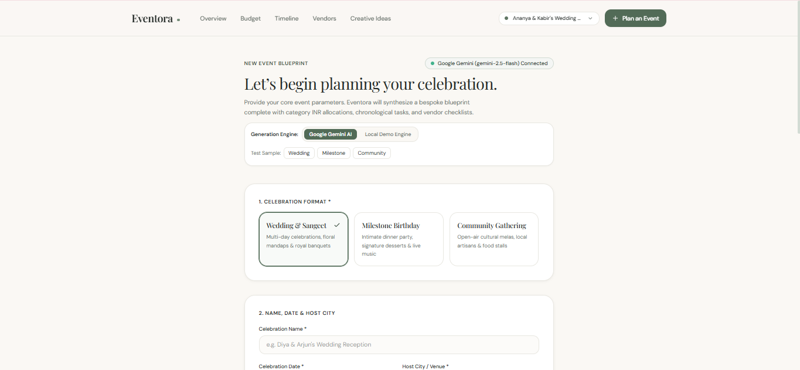
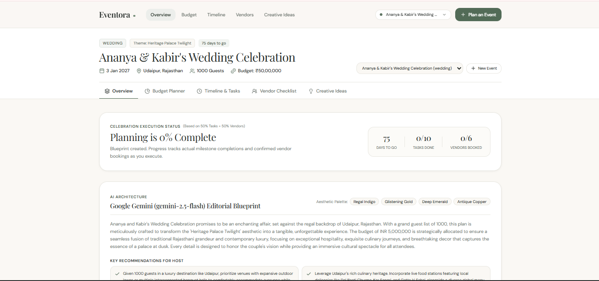
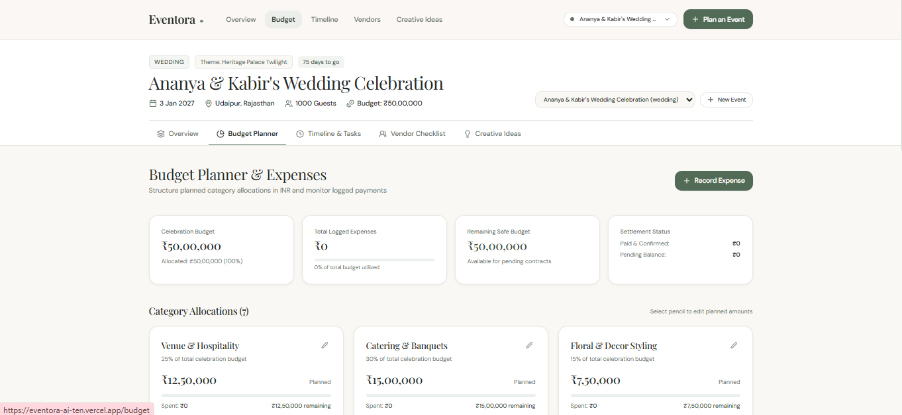
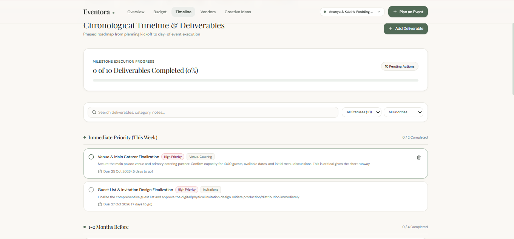
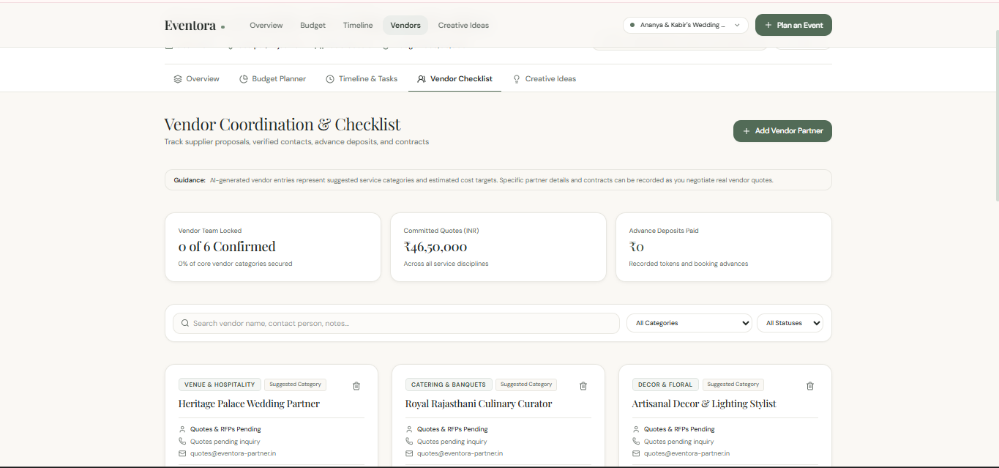
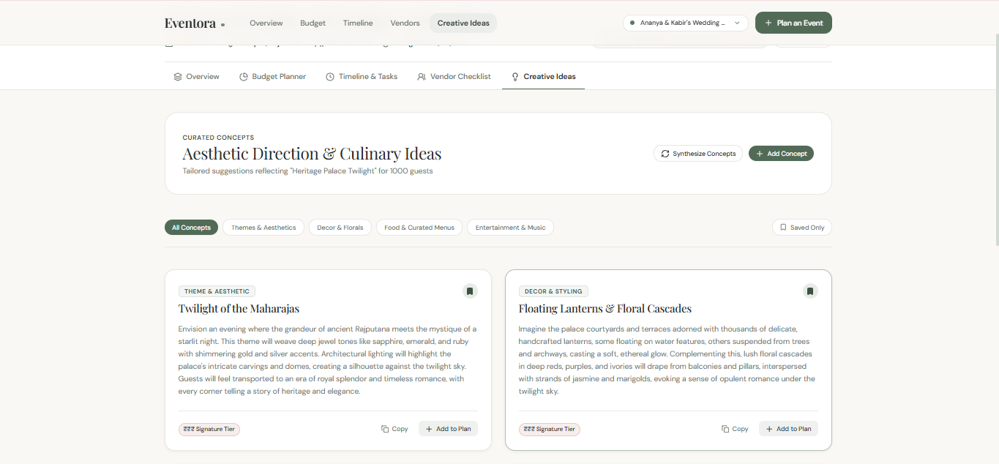
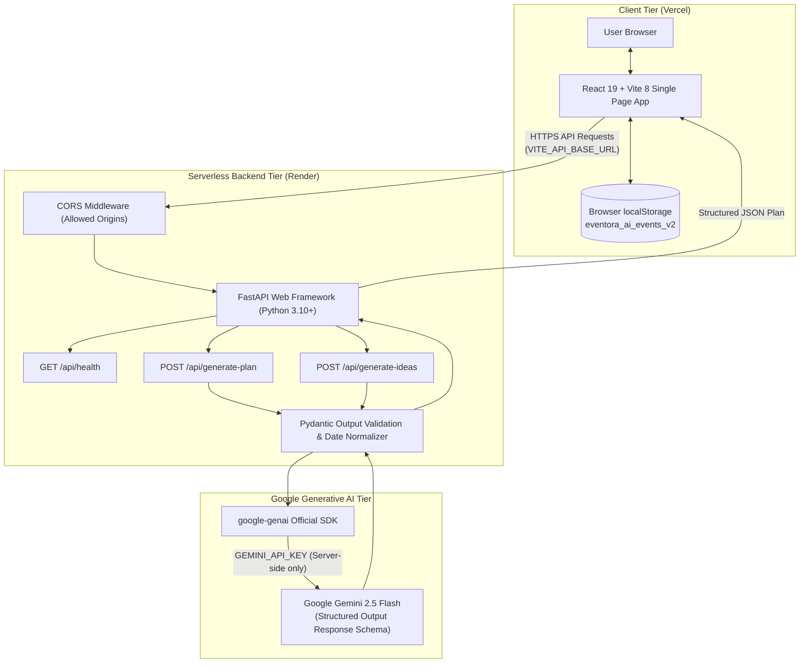
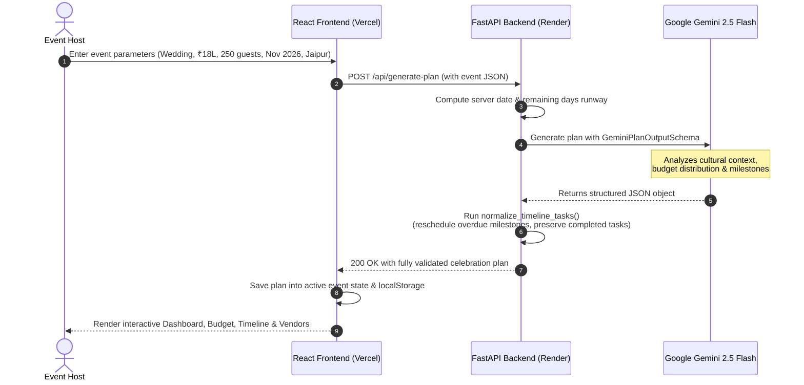

# Eventora AI

<div align="center">

### *Beautiful Moments Deserve Thoughtful Planning.*

An editorial celebration planning platform and operating system powered by **Google Gemini Generative AI** and a **Python FastAPI** backend. Designed for weddings, milestone birthdays, and community festivals.

[](https://eventora-ai-ten.vercel.app/)
[](https://github.com/pvsatvika/Eventora-AI)
[](https://eventora-ai-backend.onrender.com/api/health)

<br/>

[](https://react.dev/)
[](https://vitejs.dev/)
[](https://tailwindcss.com/)
[](https://www.python.org/)
[](https://fastapi.tiangolo.com/)
[](https://ai.google.dev/)
[](https://hack2skill.com/)

<br/>

**[🌐 Launch Live Application](https://eventora-ai-ten.vercel.app/)** &nbsp;•&nbsp; **[📡 Backend API Health](https://eventora-ai-backend.onrender.com/api/health)** &nbsp;•&nbsp; **[📂 GitHub Repository](https://github.com/pvsatvika/Eventora-AI)**

</div>

---

## 📖 Table of Contents

- [Project Overview](#-project-overview)
- [The Problem](#-the-problem)
- [Our Solution](#-our-solution)
- [Challenge 5 Alignment & Operational Assumptions](#-challenge-5-alignment-chosen-vertical--operational-assumptions)
- [Key Features](#-key-features)
- [Screenshots & Visual Preview](#-screenshots--visual-preview)
- [System Architecture](#-system-architecture)
- [Technology Stack](#-technology-stack)
- [How the AI Planning Engine Works](#-how-the-ai-planning-engine-works)
- [Getting Started](#-getting-started)
  - [Prerequisites](#prerequisites)
  - [1. Clone Repository](#1-clone-repository)
  - [2. Frontend Setup (React + Vite)](#2-frontend-setup-react--vite)
  - [3. Backend Setup (FastAPI + Python)](#3-backend-setup-fastapi--python)
- [Environment Variables](#-environment-variables)
- [API Endpoints](#-api-endpoints)
- [Production Deployment](#-production-deployment)
  - [Frontend on Vercel](#frontend-on-vercel)
  - [Backend on Render](#backend-on-render)
- [Suggested Demo Walkthrough](#-suggested-demo-walkthrough)
- [Testing & Quality Assurance](#-testing--quality-assurance)
- [Limitations & Future Roadmap](#-limitations--future-roadmap)
- [Hackathon Attribution](#-hackathon-attribution)
- [License & Intellectual Property](#-license--intellectual-property)

---

## 🌟 Project Overview

**Eventora AI** is an intelligent, full-stack celebration planning platform designed for **Hack2Skill PromptWars Challenge 5**.

Whether organizing a multi-day Indian wedding with intricate rituals, a curated milestone 30th birthday gathering, or a 400-guest community festival, traditional event planning is often stressful, fragmented across spreadsheets, and disconnected from creative design.

Eventora AI pairs the aesthetic warmth and serenity of a luxury lifestyle publication with a structured, AI-powered celebration operating system. By integrating **Google Gemini Generative AI** (`gemini-2.5-flash`) through a secure **FastAPI** backend, Eventora transforms high-level event ideas—date, location, budget in INR, attendee count, and aesthetic preferences—into an actionable, end-to-end event plan complete with category budgets, chronological timelines, vendor checklists, and creative styling concepts.

---

## 🧩 The Problem

Event hosts and couples face recurring obstacles when planning personal or community celebrations:

1. **Budget Ambiguity**: Estimating realistic category allocations (venue, catering, decor, photography) in Indian Rupee (INR) amounts without past industry benchmarks often leads to early budget exhaustion.
2. **Timeline Confusion**: Traditional planning checklists fail to adapt to how much time remains before the celebration date, resulting in unrealistic or overdue deadlines.
3. **Vendor Coordination Chaos**: Tracking vendor quotes, token deposits, contract deliverables, and booking statuses across chat threads and paper notes causes miscommunication.
4. **Generic AI Advice**: Off-the-shelf conversational chatbots provide generic bulleted lists rather than interactive, editable, persistent spreadsheets and task boards.
5. **Overwhelming, Clinical Interfaces**: Most existing event management tools look like generic corporate project trackers rather than inspiring lifestyle experiences.

---

## 💡 Our Solution

Eventora AI bridges the gap between **generative intelligence** and **tactile productivity**:

- **Structured AI Generation**: Instead of unstructured chat text, Gemini returns strictly typed JSON schemas with calibrated INR financial distributions, chronological deliverables, vendor partner checklists, and styling ideas.
- **Dynamic Date Normalization**: AI deadlines are server-validated against the current live date. Pre-event deadlines are never set in the past, and traditional milestones are intelligently compressed into upcoming actionable phases.
- **Interactive Operating Dashboard**: Every AI-generated plan is completely editable. Users can adjust category budgets, log advance payments, toggle deliverable completions, update vendor statuses, and schedule creative concepts directly into their timeline.
- **Dual-Engine Flexibility**: Features a live **Google Gemini 2.5 Flash** backend engine for custom AI generation, paired with an offline-capable **Curated Demo Engine** for instant testing without mandatory API keys.
- **Editorial Aesthetic Identity**: Built around a warm ivory (`#FAF8F4`), botanical sage green (`#748C78`), and muted blush palette with classic *Playfair Display* serif headlines and readable *DM Sans* body typography.

---

## 🎯 Challenge 5 Alignment, Chosen Vertical & Operational Assumptions

### 1. Chosen Vertical: Challenge 5 — Celebration & Event Planner
Eventora AI specifically targets the **Personal Life Milestones & Culturally Nuanced Celebrations** vertical, with dedicated engineering for:
- **Weddings & Receptions**: Multi-day Indian nuptials requiring sangeet choreography, floral mandap styling, pure-vegetarian or banquet catering, candid cinematography, and token deposit milestones.
- **Milestone Birthdays**: Curated gatherings (e.g., 30th/50th evenings) demanding craft mixology, acoustic lounge entertainment, photo guestbooks, and intimate dining.
- **Community Festivals & Cultural Melas**: 300–500 attendee neighborhood gatherings focusing on eco-friendly decor, local artisan stalls, stage permits, and waste-management logistics.

**Strategic Justification**: Unlike generic B2B conference schedulers or ticketed event portals, personal celebrations involve high emotional stakes, non-negotiable cultural nuances, complex family expense tracking in Indian Rupees, and multi-disciplinary vendor coordination.

---

### 2. Approach & Contextual Decision-Making Logic
1. **Generative AI as an Operational Blueprint, Not an Open-Ended Chatbot**:
   Conversational interfaces produce loose bullet points that force users to copy-paste into spreadsheets. Eventora AI constrains Google Gemini 2.5 Flash to strictly typed Pydantic JSON schemas, instantly materializing structured, editable data grids (budgets, deliverables, vendor rosters).
2. **Dynamic Server Date Context & Runway Compression**:
   AI prompt synthesis injects the live server date (`today = datetime.now().date()`). Traditional event milestones (e.g., locking venues 6 months out) that would otherwise be overdue are intelligently compressed into upcoming actionable horizons (`Immediate Priority (This Week)`), guaranteeing zero pre-event deadlines in the past.
3. **Dual-Engine Architecture (Zero-Barrier Evaluation)**:
   Hackathon evaluators should never be blocked by mandatory cloud billing, expired API keys, or rate limits. Eventora provides a seamless two-mode architecture:
   - **Live AI Mode**: Secure Python FastAPI backend invoking Google Gemini 2.5 Flash.
   - **Curated Demo Mode**: Deterministic local engine synthesizing realistic celebration plans offline with zero API requirements.
4. **Editorial Luxury Identity vs. Clinical Corporate Trackers**:
   Most project management tools look like generic enterprise software. Eventora utilizes a serene palette (warm ivory `#FAF8F4`, botanical sage green `#748C78`, terracotta blush `#CB8C82`, and crisp stone borders `#E8E7E1`) paired with *Playfair Display* serif headlines, creating an inspiring editorial lifestyle experience.

---

### 3. Core Technical & Domain Assumptions

| Category | Assumption in Eventora AI | Implementation & Architectural Evidence |
| :--- | :--- | :--- |
| **💰 INR Budgeting** | All financial planning operates natively in **Indian Rupees (`INR` / `₹`)** using standard Indian numbering (`₹15,00,000`, Lakhs, Crores). Allocations include a mandatory 4–5% contingency buffer and reflect regional vendor cost benchmarks. | Handled via `Intl.NumberFormat('en-IN')` in [`src/utils/currency.js`](file:///c:/Users/admin/Desktop/Eventora-AI/src/utils/currency.js) with regex sanitization preventing HTML entity leaks; server-side budget normalization in [`backend/services/gemini_service.py`](file:///c:/Users/admin/Desktop/Eventora-AI/backend/services/gemini_service.py) guarantees category sums equal 100% of the target budget. |
| **📅 Timeline Scheduling** | Pre-event deliverable deadlines are strictly bound between **today and the event date**. Pre-event deadlines never precede the current date. Negative day offsets are exclusively reserved for post-event wraps. | Validated in [`backend/services/gemini_service.py:normalize_timeline_tasks`](file:///c:/Users/admin/Desktop/Eventora-AI/backend/services/gemini_service.py) and client-side deliverable scheduler [`src/utils/date.js:calculateIdeaDeliverableDetails`](file:///c:/Users/admin/Desktop/Eventora-AI/src/utils/date.js); legacy state healed via `healLegacyEventDates` in [`src/context/EventContext.jsx`](file:///c:/Users/admin/Desktop/Eventora-AI/src/context/EventContext.jsx). |
| **🤝 Vendor Coordination** | Vendor entries represent **curated partner specifications, disciplines, and quote target benchmarks** rather than live external marketplace API integrations or real-time bank disbursements. | Modeled in [`backend/models/schemas.py:VendorChecklistGemini`](file:///c:/Users/admin/Desktop/Eventora-AI/backend/models/schemas.py) with editable lifecycle statuses (`Not Started`, `Researching`, `Contacted`, `Deposit Paid`, `Booked`) and advance token logging in [`src/components/vendors/VendorCard.jsx`](file:///c:/Users/admin/Desktop/Eventora-AI/src/components/vendors/VendorCard.jsx). |
| **💾 Browser LocalStorage** | The primary user journey assumes a **privacy-first, client-side persistence model** without forced sign-ups, authentication gates, or cloud database lock-in. | Implemented via `localStorage` key `eventora_ai_events_v2` in [`src/context/EventContext.jsx`](file:///c:/Users/admin/Desktop/Eventora-AI/src/context/EventContext.jsx) with state restoration and sample reset handlers. |
| **🔄 AI & Demo Fallback** | If the Gemini API key is missing, rate limits are reached (HTTP 429), or the backend is offline, the user experience must degrade gracefully without crashing. | Handled via [`src/utils/api.js:checkBackendHealth`](file:///c:/Users/admin/Desktop/Eventora-AI/src/utils/api.js) and non-blocking fallback modals in [`src/pages/CreateEventPage.jsx`](file:///c:/Users/admin/Desktop/Eventora-AI/src/pages/CreateEventPage.jsx). |

---

## ⚡ Key Features

| Feature | Description |
| :--- | :--- |
| **🤖 AI Celebration Blueprint Generator** | Synthesizes an entire celebration operating plan from event type, budget (INR), date, location, guest count, and aesthetic theme preferences. |
| **💰 INR Budget Planner & Expense Tracker** | Allocates celebration budgets across categories (Venue, Catering, Floral & Decor, Photography, Entertainment, Contingency) with inline editing, expense logging, settlement tracking, and deficit warnings. |
| **📅 Phased Chronological Timeline** | Deliverables sequenced from planning kickoff down to the day of the event and post-event wraps. Includes past-date healing, priority badges, and overdue detection. |
| **🤝 Vendor Coordination Checklist** | Tracks vendor disciplines, suggested service titles, estimated cost quotes, token deposits, contact persons, notes, and booking statuses (`Not Started` to `Booked`). |
| **✨ Creative Ideas Synthesizer** | Generates bespoke concepts for themes, decor, food & cocktails, and entertainment. Clicking *"Add to Plan"* calculates an appropriate preparation deadline and adds it directly to the timeline. |
| **🔔 Non-Blocking Toast Notifications** | Tasteful, accessible notification system replacing disruptive browser alerts with contextual feedback and direct navigation links. |
| **📊 Holistic Celebration Dashboard** | Live readiness score calculation (derived from completed deliverables and secured vendor contracts), days-to-go countdown, budget utilization bars, and urgent action items. |
| **💾 LocalStorage Persistence** | All updates, expenses, customized tasks, and event switches are saved locally (`eventora_ai_events_v2`) with automatic legacy data self-healing. |
| **🗂️ Multi-Event Manager** | Switch seamlessly between different celebrations, create new blueprints, or reset back to curated templates. |

---

## 📸 Screenshots & Visual Preview

### 1. Editorial Landing Page

*A serene, editorial split-screen landing page welcoming users with thoughtful lifestyle typography, celebration category showcases, interactive preview celebrations, and a transparent feature roadmap.*

---

### 2. Event Blueprint Generator (`/create`)

*Interactive celebration setup interface featuring real-time Google Gemini backend connectivity detection, INR budget sliders, guest volume parameters, and cultural aesthetic preferences.*

---

### 3. Celebration Dashboard (`/dashboard`)

*Centralized event control room displaying the verified Celebration Readiness Score (calculated from actual completed deliverables and secured vendors), days-to-go countdown breakdown, budget utilization gauges, and urgent priority action items.*

---

### 4. Budget Planner & Expense Log (`/budget`)

*Dynamic category allocations in Indian Rupees (`Intl.NumberFormat('en-IN')`) with inline edit controls, full expense log with receipt tracking, paid/pending status toggles, and safe remaining balance calculations.*

---

### 5. Chronological Timeline & Tasks (`/timeline`)

*Phased celebration roadmap sequenced from initial kickoff through day-of execution and post-event wraps, featuring smart past-date prevention, priority tags, and milestone execution progress.*

---

### 6. Vendor Checklist (`/vendors`)

*Comprehensive vendor coordination checklist tracking recommended service disciplines, estimated target quotes, recorded token deposits, contact details, and booking lifecycle statuses.*

---

### 7. Creative Ideas Synthesizer (`/ideas`)

*AI-synthesized design concepts spanning themes, decor, culinary items, and entertainment. Clicking "Add to Plan" automatically schedules deliverables with appropriate pre-event preparation deadlines and duplicate protection.*

---

## 🏗️ System Architecture

Eventora AI operates on a modern, decoupled full-stack architecture that isolates generative AI keys on a Python server while delivering a snappy, zero-latency React client:



### Architecture Highlights
1. **Zero Secret Exposure**: The `GEMINI_API_KEY` is loaded strictly inside Python via `python-dotenv` from `backend/.env`. It is never bundled into client JavaScript or accessible via browser network headers.
2. **Deterministic Schemas**: Uses Pydantic's `response_schema` alongside Gemini's structured output mode to guarantee typed outputs without broken markdown formatting.
3. **Client-Side State Autonomy**: The client maintains complete offline independence via React Context and `localStorage`, ensuring data persists across page refreshes.

---

## 🛠️ Technology Stack

| Layer | Technology | Version | Purpose in Eventora AI |
| :--- | :--- | :--- | :--- |
| **Frontend Framework** | **React** | `^19.3.1` | Component-driven UI, state management, and hooks |
| **Build Tool & Bundler** | **Vite** | `^8.3.4` | Lightning-fast development server and optimized build pipeline |
| **Styling & Design** | **Tailwind CSS** | `^4.3.3` | Utility-first responsive design, custom ivory & sage palette |
| **Icons** | **Lucide React** | `^1.60.0` | Clean, modern lifestyle and navigation icons |
| **Client Routing** | **React Router DOM** | `^7.18.4` | Client-side routing between landing, dashboard, and planners |
| **Delight / Feedback** | **Canvas Confetti** | `^1.9.4` | Celebration completion celebratory visual effects |
| **Backend Framework** | **FastAPI** | `>=0.115.0` | High-performance asynchronous Python REST API |
| **ASGI Web Server** | **Uvicorn** | `>=0.30.0` | Production ASGI web server running FastAPI |
| **AI SDK** | **google-genai** | `>=2.17.0` | Official Google Gen AI Python SDK interfacing with Gemini |
| **Data Validation** | **Pydantic** | `>=2.8.0` | Strict request validation and structured output response schemas |
| **Environment Config** | **python-dotenv** | `>=1.0.0` | Secure environment variable management |
| **HTTP Client** | **HTTPX** | `>=0.28.0` | High-level async HTTP client support |
| **Frontend Deployment** | **Vercel** | — | Production static SPA hosting with HTTPS & CDN edge delivery |
| **Backend Deployment** | **Render** | — | Fully managed Python cloud web service |

---

## 🧠 How the AI Planning Engine Works



1. **Parameter Gathering**: The user specifies event type, title, location, target date, budget in INR, attendee count, and design vision.
2. **Context Enrichment**: The FastAPI service computes the live calendar difference between the current server date and the event date.
3. **Structured Prompting**: The backend constructs an enriched prompt instructing Gemini to act as a luxury event planner with deep cultural awareness (e.g. Indian wedding traditions, Sangeet choreography, milestone birthdays).
4. **Structured Schema Enforcement**: Output is constrained using Pydantic schemas (`GeminiPlanOutputSchema`), ensuring budget percentages total 100% and tasks have valid relative offsets.
5. **Timeline Normalization**: The backend checks generated task deadlines against today's date. Any milestone that would traditionally fall in the past is automatically rescheduled into an immediate upcoming actionable phase.
6. **Seamless State Ingestion**: The frontend receives the normalized payload, binds it to the active celebration ID, saves it in `localStorage`, and transitions the user to the interactive dashboard.

---

## 🚀 Getting Started

Follow these steps to run the complete Eventora AI full-stack application on your local machine.

### Prerequisites
- **Node.js**: v18.0.0 or higher ([Download Node.js](https://nodejs.org/))
- **Python**: v3.10 or higher ([Download Python](https://www.python.org/))
- **Git**: Installed and configured
- **Google Gemini API Key**: Free key from [Google AI Studio](https://aistudio.google.com/)

---

### 1. Clone Repository

```bash
git clone https://github.com/pvsatvika/Eventora-AI.git
cd Eventora-AI
```

---

### 2. Frontend Setup (React + Vite)

In the root repository directory:

```bash
# 1. Install frontend dependencies
npm install

# 2. Configure environment (optional for local dev)
# By default, api.js points to http://localhost:8000 if VITE_API_BASE_URL is omitted.
cp .env.example .env

# 3. Start the Vite development server
npm run dev
```

The frontend will start at:  
👉 **`http://localhost:5173/`**

---

### 3. Backend Setup (FastAPI + Python)

Open a **second terminal window** and navigate into the `backend/` directory:

```bash
cd backend

# 1. Create a Python virtual environment
python -m venv venv

# 2. Activate the virtual environment
# On Windows PowerShell:
.\venv\Scripts\Activate.ps1
# On Windows Command Prompt:
.\venv\Scripts\activate.bat
# On macOS / Linux:
source venv/bin/activate

# 3. Install Python dependencies
pip install -r requirements.txt

# 4. Configure your backend environment
cp .env.example .env
```

Open `backend/.env` in your text editor and insert your Gemini API key:

```env
# Google Gemini API Key from Google AI Studio
GEMINI_API_KEY=your_actual_gemini_api_key_here

# Configurable Gemini Model
GEMINI_MODEL=gemini-2.5-flash

# Port for local FastAPI server
PORT=8000

# Allowed Frontend Origins for CORS
CORS_ORIGINS=http://localhost:5173,http://127.0.0.1:5173,http://localhost:4173
```

Now start the FastAPI backend server:

```bash
python main.py
# Or directly via uvicorn:
uvicorn main:app --reload --port 8000
```

The backend server will start at:
- **API Root**: `http://localhost:8000/`
- **Health Check**: `http://localhost:8000/api/health`
- **Interactive Swagger Docs**: `http://localhost:8000/docs`

---

## 🔐 Environment Variables

### Frontend Variables (`.env` in root)

| Variable | Required | Default | Description |
| :--- | :---: | :--- | :--- |
| `VITE_API_BASE_URL` | **Production** | `http://localhost:8000` | Points to deployed FastAPI backend (e.g. `https://eventora-ai-backend.onrender.com`). |

> [!IMPORTANT]
> Never place `GEMINI_API_KEY` in the frontend root `.env` or prefix it with `VITE_`. Gemini API calls must execute exclusively through the backend.

### Backend Variables (`backend/.env`)

| Variable | Required | Default | Description |
| :--- | :---: | :--- | :--- |
| `GEMINI_API_KEY` | **Yes** | *None* | Valid Google Gemini API key obtained from [Google AI Studio](https://aistudio.google.com/). |
| `GEMINI_MODEL` | No | `gemini-2.5-flash` | Configurable Google Gen AI model name (`gemini-2.5-flash`, `gemini-2.0-flash`, etc.). |
| `PORT` | No | `8000` | Port for the Uvicorn ASGI server to bind. Injected automatically on Render. |
| `CORS_ORIGINS` | No | `http://localhost:5173,...` | Comma-separated list of allowed browser origins for cross-origin requests. |

---

## 📡 API Endpoints

The FastAPI backend exposes three purpose-built REST endpoints:

### 1. `GET /api/health`
Verifies backend operational status and whether a non-placeholder Gemini API key is loaded.

**Sample Response**:
```json
{
  "status": "ok",
  "gemini_configured": true,
  "model": "gemini-2.5-flash",
  "version": "1.0.0"
}
```

---

### 2. `POST /api/generate-plan`
Accepts user event parameters and generates a complete celebration blueprint.

**Sample Request Payload**:
```json
{
  "event_type": "wedding",
  "event_name": "Ananya & Kabir's Royal Sangeet & Reception",
  "event_date": "2026-11-20",
  "location": "Jaipur, Rajasthan",
  "total_budget": 1800000,
  "guest_count": 250,
  "theme_preferences": "Royal Rajputana with Twilight Gold & Pastel Florals",
  "special_requirements": "Strictly vegetarian banquet and step-free wheelchair access",
  "existing_completed_tasks": []
}
```

**Key Response Fields**:
- `overview_summary`: Tailored editorial narrative for the celebration.
- `theme_palette`: 3 to 4 complementary aesthetic colors/motifs.
- `key_recommendations`: Practical tips based on location, guest volume, and season.
- `budget_categories`: Recommended INR allocations totaling 100% of the total budget.
- `timeline_tasks`: Chronological deliverables with normalized due dates and phases.
- `vendor_checklist`: Recommended vendor disciplines with estimated costs in INR.
- `creative_ideas`: Tailored creative styling and entertainment concepts.

---

### 3. `POST /api/generate-ideas`
Synthesizes fresh creative concepts categorized by theme, decor, food & beverages, or entertainment.

**Sample Request Payload**:
```json
{
  "event_name": "Ananya & Kabir's Royal Sangeet & Reception",
  "event_type": "wedding",
  "theme": "Royal Rajputana",
  "guest_count": 250,
  "total_budget": 1800000,
  "location": "Jaipur, Rajasthan",
  "category": "all"
}
```

**Sample Response**:
```json
{
  "ideas": [
    {
      "type": "decor",
      "title": "Marigold & Brass Candle Cascade",
      "tag": "Decor & Styling",
      "description": "Suspended brass thalis with fragrant marigolds and slow-burning candlelight along entry corridors.",
      "cost_impact": "Moderate"
    }
  ]
}
```

---

## 🌐 Production Deployment

Eventora AI is deployed across high-availability cloud infrastructure:

### Frontend on Vercel
- **Production URL**: [https://eventora-ai-ten.vercel.app/](https://eventora-ai-ten.vercel.app/)
- **Repository Root**: `./`
- **Framework Preset**: Vite
- **Build Command**: `npm run build`
- **Output Directory**: `dist`
- **Environment Variables**:
  - `VITE_API_BASE_URL` = `https://eventora-ai-backend.onrender.com`

### Backend on Render
- **Production URL**: [https://eventora-ai-backend.onrender.com](https://eventora-ai-backend.onrender.com)
- **Root Directory**: `backend`
- **Environment**: Python 3
- **Build Command**: `pip install -r requirements.txt`
- **Start Command**: `uvicorn main:app --host 0.0.0.0 --port $PORT`
- **Environment Variables**:
  - `GEMINI_API_KEY` = `[Configured in Render Secrets]`
  - `GEMINI_MODEL` = `gemini-2.5-flash`
  - `CORS_ORIGINS` = `https://eventora-ai-ten.vercel.app,http://localhost:5173`

---

## 🧭 Suggested Demo Walkthrough

Judges and evaluators can follow this step-by-step walkthrough to test the full feature set:

1. **Landing Page Exploration**: Open [https://eventora-ai-ten.vercel.app/](https://eventora-ai-ten.vercel.app/). Review the editorial aesthetic, category cards, interactive preview celebration, and workflow breakdown. Click **"Plan Your Celebration"**.
2. **Create Celebration (`/create`)**:
   - Select an event category (e.g. **Wedding & Sangeet**).
   - Notice the live badge in the top right: `Google Gemini (gemini-2.5-flash) Connected`.
   - Fill in or customize the event parameters (e.g. Budget: ₹18,00,000, Date: 3+ months ahead, City: Jaipur).
   - Click **"Generate Celebration Blueprint"**. Watch the dynamic progress stage indicators.
3. **Explore Dashboard (`/dashboard`)**:
   - Inspect the **Celebration Readiness Score** (dynamically computed from completed tasks and vendor bookings).
   - Review the **Days to Go** countdown and budget allocation progress bars.
4. **Manage Budget (`/budget`)**:
   - Review AI-distributed category allocations formatted in INR (`₹`).
   - Click the pencil icon on any category to adjust the planned allocation.
   - Click **"Record Expense"** to log an advance payment or venue deposit.
   - Observe the safe remaining budget balance and settlement totals recalculating in real-time.
5. **Execute Timeline Milestones (`/timeline`)**:
   - Browse chronological deliverables grouped into phased horizons.
   - Click deliverable checkboxes to mark milestones completed; observe the progress bar updating.
   - Click **"Add Deliverable"** to add a custom action item.
6. **Coordinate Vendors (`/vendors`)**:
   - Examine recommended vendor roles and estimated target quotes.
   - Change a vendor's booking status from `Researching` to `Deposit Paid` or `Booked`.
   - Return to the Dashboard and watch the **Readiness Score** rise accordingly.
7. **Synthesize Creative Ideas (`/ideas`)**:
   - Browse curated concepts across Themes, Decor, Food, and Entertainment.
   - Click **"Add to Plan"** on an idea card: notice the non-blocking toast confirming the deliverable was scheduled before the event date.
   - Click the idea again to verify duplicate deliverable protection.
8. **Event Manager (`/events`)**:
   - Navigate to **Celebrations** in the top navigation.
   - Switch between sample events or manage saved celebrations stored in `localStorage`.

---

## 🧪 Testing & Quality Assurance

Eventora AI includes an automated full-stack testing suite covering the Python FastAPI backend, Gemini generative AI services, frontend utilities, React state management, and UI components.

### 🧰 Testing Frameworks & Tools

- **Backend Testing**: **pytest** (`>=9.1.1`) paired with FastAPI's **TestClient** (`httpx`) and `unittest.mock` for zero-cost offline Gemini simulation.
- **Frontend Testing**: **Vitest** (`^5.0.5`), **React Testing Library** (`^16.3.3`), and **jsdom** (`^30.1.3`).
- **Static Analysis & Linting**: **oxlint** (`^1.88.0`) for fast Rust-based code-quality verification.
- **Production Bundling**: **Vite** (`^8.3.4`) validating TypeScript and React compilation integrity.

---

### 💻 Test Execution Commands

#### Run Frontend Test Suite
From the repository root:
```bash
# Run all Vitest unit and integration tests
npm run test

# Run tests in interactive watch mode
npx vitest
```

#### Run Backend Test Suite
From the repository root (or within `backend/`):
```bash
# Run all pytest backend tests with verbose output
python -m pytest backend/tests -v

# Run with test coverage (optional)
python -m pytest backend/tests --tb=short
```

#### Run Code Quality & Linter
```bash
npm run lint
```

#### Run Production Build Verification
```bash
npm run build
```

---

### 📋 Test Coverage Breakdown

#### 1. Backend Automated Tests (`backend/tests/` — 38 Tests)
- **API Health & Configuration (`test_health.py`)**:
  - `GET /api/health` returns status code 200 and schema with model, status, and version.
  - Accurate detection when Gemini API key is configured vs unconfigured.
- **Input Validation & Schemas (`test_schemas.py`)**:
  - `EventPlanRequest` parameter parsing and defaults.
  - Strict YYYY-MM-DD date regex validation and automatic whitespace trimming.
  - **Calendar Integrity**: Rejection of impossible dates (e.g., February 31, April 31, month 13, non-leap year Feb 29).
  - **Leap Year Support**: Validates leap day dates (e.g., `2028-02-29`) cleanly.
  - **Year Range Guard**: Restricts dates to sensible horizon (2024–2099).
  - Rejection of invalid event types (restricts strictly to `wedding`, `birthday`, `community`).
  - Strict budget boundaries (validates ₹5,000 minimum up to ₹50,00,00,000 maximum).
  - Guest count bounds checking (1 to 10,000 attendees).
  - `GenerateIdeasRequest` bounds and field length limits.
  - Pydantic sub-schemas for Gemini structured outputs (`BudgetCategoryGemini`, `TimelineTaskGemini`, `VendorChecklistGemini`, `CreativeIdeaGemini`).
- **Timeline Date Normalization (`test_timeline_normalization.py`)**:
  - Chronological ordering of generated milestones.
  - **Past-Date Prevention**: Milestones that would fall in the past relative to the current server date are rescheduled to upcoming actionable dates between today and the event date, marked with `priority: high` and overdue action notices.
  - **Post-Event Milestones**: Tasks with negative offsets (e.g. vendor settlements, album delivery) are scheduled after the event date with `phase: Post Event`.
  - **State Preservation**: Completed task states (`completed: true`) are preserved across plan regenerations.
- **Gemini Service & Security (`test_gemini_service.py`)**:
  - `get_api_key()` detects and neutralizes placeholder keys (`YOUR_API_KEY_HERE`, `PLACEHOLDER`, empty strings) without leaking secrets.
  - `GeminiService.generate_event_plan()` raises HTTP 503 when unconfigured.
  - Offline Mock Gemini execution parses structured JSON and ensures category allocations sum exactly to 100% of the requested budget.
  - `GeminiService.generate_creative_ideas()` parses tailored concepts.
  - **Markdown Fence Stripping**: `extract_clean_json` safely handles markdown-wrapped responses (` ```json ... ``` `).
  - **Resilient Error Handling**: Empty text raises HTTP 502, malformed JSON raises HTTP 502, and Gemini `APIError` subtypes map accurately to HTTP 401, 404, and 429.
  - **Secret Redaction**: `sanitize_error_message()` actively redacts Gemini API keys (`AIza...`) and query parameters (`key=...`) from external API exceptions before sending responses.
- **REST Endpoints & Concurrency (`test_api_endpoints.py`)**:
  - `POST /api/generate-plan` returns 200 with complete celebration payload.
  - `POST /api/generate-plan` returns 422 Unprocessable Entity on missing or invalid parameters.
  - `POST /api/generate-ideas` returns 200 with categorized ideas.
  - **CORS Security**: Verifies local development origins, production Vercel origins (`https://eventora-ai-ten.vercel.app`), and project preview domains (`https://eventora-ai-*.vercel.app`), while strictly rejecting unrelated origins.
  - **Information Exposure Prevention**: Verifies unhandled internal server exceptions return sanitized 500 error messages without leaking server stack traces.
  - **Async Concurrency & Non-Blocking Execution**: Validates that generative AI endpoints execute synchronously in FastAPI's external worker threadpool to prevent blocking the main asyncio event loop.

#### 2. Frontend Automated Tests (`src/test/` — 61 Tests)
- **Currency Utilities (`src/test/currency.test.js` — 8 tests)**:
  - Standard Indian numbering formatting (`₹15,00,000`).
  - Zero formatting sanitization guaranteeing clean `₹0` without HTML entities.
  - String number coercion and negative balance handling.
  - Compact summaries across Thousands (`K`), Lakhs (`Lakh`), and Crores (`Cr`).
  - `parseINRInput` parsing formatted strings back to integers.
- **Date & Scheduling Utilities (`src/test/date.test.js` — 11 tests)**:
  - `formatDate` readable string formatting and invalid date fallback (`TBD`).
  - `getDaysUntil` calculations, past date detection, and countdown labels.
  - `calculateIdeaDeliverableDetails`:
    - 30-day preparation offset for Theme & Aesthetic concepts.
    - 21-day offset for Entertainment & Music concepts.
    - 14-day offset for Decor, Styling, and Culinary concepts.
    - Proportional runway compression for short-notice events.
    - Same-day deadline assignment (`Day of Event`) without past dates.
    - Local timezone accuracy without UTC date drift.
- **EventContext & Persistence (`src/test/EventContext.test.jsx` — 7 tests)**:
  - Initial state hydration from `localStorage`.
  - Event creation (`createNewEvent`) and active celebration switching.
  - Category budget allocation adjustments (`updateBudgetCategory`).
  - Expense lifecycle (`addExpense`, `updateExpense` paid/pending toggles, `deleteExpense`).
  - Timeline deliverables management (`toggleTask`, `addTask`).
  - Vendor checklist lifecycle (`updateVendor` booking status changes, `addVendor`).
  - Creative concept bookmarking (`toggleIdeaFavorite`, `addCustomIdea`).
- **UI & Domain Components (`src/test/components.test.jsx` — 8 tests)**:
  - `Toast`: accessible status notification, action links, auto-dismiss, and manual dismiss handlers.
  - `ProgressBar`: percentage width calculation and bounds clamping.
  - `Badge`: botanical and editorial variant token styling.
  - `TaskItem`: deliverable rendering, strikethrough styling upon completion, priority tags, and accessible toggle/delete buttons.
  - `BudgetCategoryCard`: allocated vs spent displays, inline edit mode toggle, numeric inputs, and save/cancel actions.
  - `VendorCard`: booking status selection dropdown with connected labels, contact info display, and status update callbacks.
  - `IdeaCard`: concept title, copy-to-clipboard, "Add to Plan" callback, "In Plan" disabled state, and favorite bookmark toggle.
- **Modal Dialog Accessibility (`src/test/Modal.test.jsx` — 7 tests)**:
  - `role="dialog"` and `aria-modal="true"` markup verification.
  - Accessible `aria-labelledby` and `aria-describedby` linking.
  - Keyboard accessibility: closes on `Escape` key press.
  - Focus management: automatically shifts focus into interactive elements inside the dialog upon opening.
  - Backdrop dismissal and click propagation containment.
  - Accessible close button with `aria-label="Close dialog"`.
- **Expense Table & Ledger (`src/test/ExpenseTable.test.jsx` — 7 tests)**:
  - Accessible ledger table with `scope="col"` headers and accessible label.
  - Search filtering by expense title and payee vendor.
  - Dropdown filtering by celebration budget category.
  - Dropdown filtering by payment status (`paid` vs `pending`).
  - Interactive payment status toggles with descriptive ARIA announcements.
  - Expense deletion callback and empty state rendering.
- **Celebration Creation Workflow (`src/test/CreateEventPage.test.jsx` — 4 tests)**:
  - Form rendering with celebration presets (Wedding, Birthday, Community).
  - One-click sample template quick-fill verifying automatic field population.
  - Client-side form validation displaying explicit error messages on empty submissions.
  - Full creation submission: validates input, updates active celebration state, and redirects smoothly to `/dashboard`.
- **Celebration Dashboard (`src/test/DashboardPage.test.jsx` — 3 tests)**:
  - Renders active celebration overview, health indicator, and navigation action buttons without runtime crash.
  - Verifies Lucide icon integration (`ArrowRight`, `Check`) and deliverable completion toggling.
  - Empty state fallback gracefully handles missing active celebration with call-to-action link.
- **Frontend API Client (`src/test/api.test.js` — 6 tests)**:
  - Sanitization of `API_BASE_URL` ensuring no trailing slashes.
  - `checkBackendHealth` handling both connected 200 states and offline error fallbacks.
  - `generateEventPlanWithAI` payload construction and descriptive error propagation.
  - `generateIdeasWithAI` parameter passing and response parsing.

---

### 📊 Actual Test Results

```text
============================= pytest backend test session =============================
platform win32 -- Python 3.14.3, pytest-9.1.1, pluggy-1.7.0
rootdir: C:\Users\admin\Desktop\Eventora-AI
collected 38 items

backend/tests/test_api_endpoints.py::test_post_generate_plan_valid PASSED            [  3%]
backend/tests/test_api_endpoints.py::test_post_generate_plan_invalid_input PASSED   [  7%]
backend/tests/test_api_endpoints.py::test_post_generate_plan_unconfigured_gemini PASSED [ 11%]
backend/tests/test_api_endpoints.py::test_post_generate_ideas_valid PASSED          [ 15%]
backend/tests/test_cors_headers_present PASSED               [ 13%]
backend/tests/test_api_endpoints.py::test_cors_production_and_vercel_preview PASSED [ 16%]
backend/tests/test_api_endpoints.py::test_unhandled_exception_returns_sanitized_500 PASSED [ 19%]
backend/tests/test_api_endpoints.py::test_route_handlers_are_sync_threadpool_functions PASSED [ 21%]
backend/tests/test_gemini_service.py::test_get_api_key_valid PASSED                 [ 23%]
backend/tests/test_gemini_service.py::test_get_api_key_detects_placeholders PASSED  [ 26%]
backend/tests/test_gemini_service.py::test_get_model_name_default PASSED            [ 30%]
backend/tests/test_gemini_service.py::test_gemini_service_raises_503_when_unconfigured PASSED [ 34%]
backend/tests/test_gemini_service.py::test_gemini_service_generate_plan_mocked PASSED [ 38%]
backend/tests/test_gemini_service.py::test_gemini_service_generate_ideas_mocked PASSED [ 36%]
backend/tests/test_gemini_service.py::test_extract_clean_json_markdown_fences PASSED [ 38%]
backend/tests/test_gemini_service.py::test_gemini_service_empty_text_raises_502 PASSED [ 41%]
backend/tests/test_gemini_service.py::test_gemini_service_malformed_json_raises_502 PASSED [ 44%]
backend/tests/test_gemini_service.py::test_gemini_service_api_error_subtypes PASSED [ 47%]
backend/tests/test_gemini_service.py::test_sanitize_error_message_redacts_secrets PASSED [ 49%]
backend/tests/test_health.py::test_health_check_returns_200 PASSED                  [ 51%]
backend/tests/test_health.py::test_health_check_configured_state PASSED             [ 50%]
backend/tests/test_health.py::test_health_check_unconfigured_state PASSED           [ 53%]
backend/tests/test_schemas.py::test_valid_event_plan_request PASSED                 [ 57%]
backend/tests/test_schemas.py::test_invalid_event_type_rejected PASSED              [ 61%]
backend/tests/test_schemas.py::test_invalid_date_format_rejected PASSED             [ 65%]
backend/tests/test_schemas.py::test_date_validator_strips_whitespace PASSED        [ 69%]
backend/tests/test_schemas.py::test_budget_boundary_validation PASSED               [ 73%]
backend/tests/test_schemas.py::test_guest_count_boundary_validation PASSED          [ 76%]
backend/tests/test_schemas.py::test_generate_ideas_request PASSED                   [ 80%]
backend/tests/test_schemas.py::test_gemini_component_schemas PASSED                 [ 77%]
backend/tests/test_schemas.py::test_invalid_calendar_dates_rejected PASSED         [ 80%]
backend/tests/test_schemas.py::test_valid_leap_year_accepted PASSED                 [ 83%]
backend/tests/test_schemas.py::test_year_range_validation PASSED                    [ 86%]
backend/tests/test_schemas.py::test_generate_ideas_request_bounds PASSED            [ 88%]
backend/tests/test_timeline_normalization.py::test_normalize_normal_future_tasks PASSED [ 91%]
backend/tests/test_timeline_normalization.py::test_normalize_reschedules_past_milestones PASSED [ 92%]
backend/tests/test_timeline_normalization.py::test_normalize_post_event_tasks PASSED [ 96%]
backend/tests/test_timeline_normalization.py::test_normalize_preserves_completed_tasks PASSED [100%]

================================= 38 passed in 0.20s ==================================

----------------------------------------------------------------------------------------

 RUN  v5.0.5 C:/Users/admin/Desktop/Eventora-AI

 ✓ src/test/date.test.js (11 tests)
 ✓ src/test/api.test.js (6 tests)
 ✓ src/test/EventContext.test.jsx (7 tests)
 ✓ src/test/Modal.test.jsx (7 tests)
 ✓ src/test/components.test.jsx (8 tests)
 ✓ src/test/ExpenseTable.test.jsx (7 tests)
 ✓ src/test/DashboardPage.test.jsx (3 tests)
 ✓ src/test/CreateEventPage.test.jsx (4 tests)
 ✓ src/test/currency.test.js (8 tests)

 Test Files  9 passed (9)
      Tests  61 passed (61)
   Duration  5.82s

----------------------------------------------------------------------------------------
TOTAL AUTOMATED TESTS: 99 PASSED / 0 FAILED (100% Pass Rate)
LINT STATUS: 0 Warnings, 0 Errors across 48 files
BUILD STATUS: 0 Errors (built in 2.20s)
```

---

## ⚠️ Limitations & Future Roadmap

To uphold technical documentation integrity, the following outlines current implementation boundaries and planned enhancements:

### Current Limitations
- **Client-Side Storage**: Data is persisted locally within the user's browser `localStorage`. Clearing browser cache resets state to initial defaults.
- **Simulated Vendor Directory**: AI vendor entries provide realistic suggested categories, estimated quote targets, and checklists; they are not connected to live external vendor directory APIs.
- **Manual Expense Settlement**: The budget tracker facilitates manual financial record-keeping in INR; it does not process live bank transactions or real credit card payments.
- **Single-User Workspace**: There is currently no multi-tenant authentication system for simultaneous multi-user collaboration.

### Future Roadmap
- [ ] **Cloud Persistence & Auth**: Optional user accounts via Supabase / PostgreSQL for cross-device synchronization.
- [ ] **Collaborative Planning**: Shared invite links allowing co-hosts, partners, and family committees to edit simultaneously.
- [ ] **Document Export**: One-click export of timelines and budget balance sheets to PDF, Google Calendar, and Excel (.xlsx).
- [ ] **Guest RSVP Portal**: Simple link generator for attendees to submit dietary requirements and confirm attendance.

---

## 🏆 Hackathon Attribution

Eventora AI was designed, built, and submitted for:
- **Hackathon**: [Hack2Skill PromptWars Challenge 5](https://hack2skill.com/)
- **Track**: Generative AI Celebration Planning Web Application
- **Author & Maintainer**: **Satvika PV** ([@pvsatvika](https://github.com/pvsatvika))
- **Repository**: [https://github.com/pvsatvika/Eventora-AI](https://github.com/pvsatvika/Eventora-AI)

---

## 📜 License & Intellectual Property

This repository does not currently contain an open-source license file. All rights are reserved by the author (**Satvika PV**) for the **Hack2Skill PromptWars Challenge 5** hackathon submission. For collaboration or permission requests, please contact the maintainer via [GitHub](https://github.com/pvsatvika/Eventora-AI).

---

<div align="center">

### Eventora AI
*Bringing thoughtfulness, serenity, and intelligence to life's most meaningful moments.*

[🌟 Star on GitHub](https://github.com/pvsatvika/Eventora-AI) &nbsp;•&nbsp; [🚀 Open Live App](https://eventora-ai-ten.vercel.app/) &nbsp;•&nbsp; [🐛 Report an Issue](https://github.com/pvsatvika/Eventora-AI/issues)

</div>
